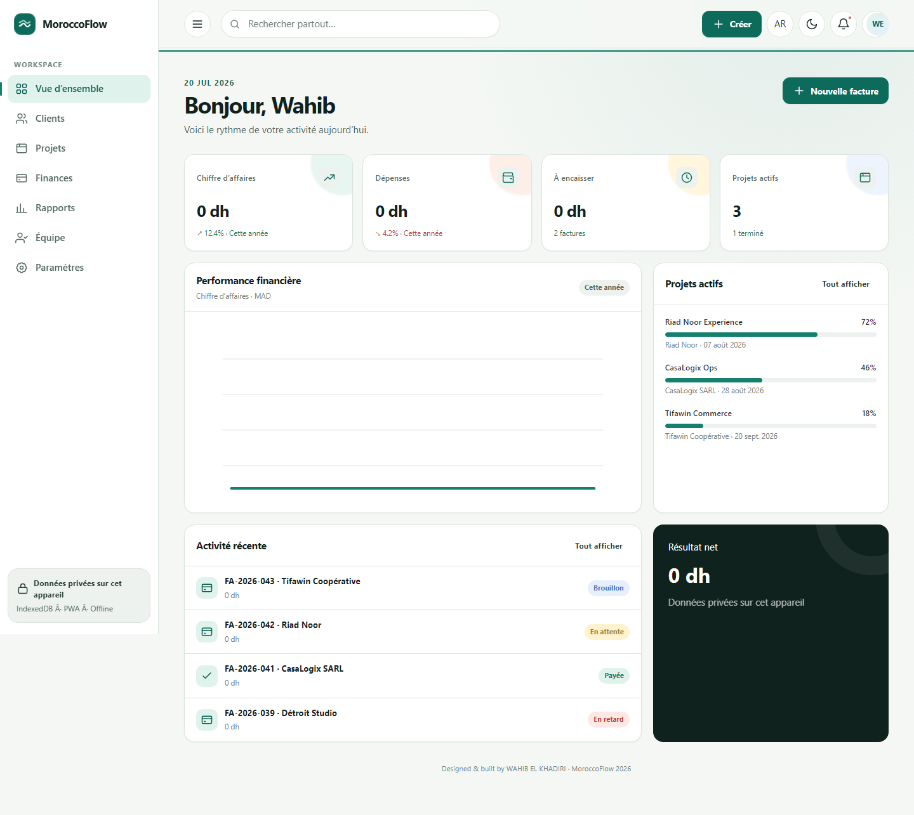

# MoroccoFlow

**Business, in flow.** Une plateforme de gestion bilingue et originale destinée aux entreprises
marocaines, conçue et développée par **WAHIB EL KHADIRI**.

[](https://github.com/WAHIB-EL-KHADIRI/MoroccoFlow-/actions/workflows/ci.yml)



## Fonctionnalités

- CRM, fiches clients marocaines et pipeline commercial
- Projets et tâches Kanban accessibles au clavier
- Devis, factures, dépenses et revenus en dirhams marocains
- Tableau de bord, rapports Chart.js, CSV sécurisé et impressions PDF
- Invitations d'équipe, RBAC côté serveur et journal d'audit en ajout seul
- Français/arabe, RTL/LTR, modes clair/sombre et responsive complet
- Cache IndexedDB, file de mutations hors ligne, Service Worker et PWA
- Sessions rotatives, verrouillage, mots de passe Argon2id et MFA TOTP
- Documents S3 avec validation du contenu et quarantaine antivirus

Toutes les sociétés et personnes de démonstration sont fictives. Les montants de démonstration
affichent volontairement `0 dh`. Aucun template ni code produit tiers n'a été copié.

## Deux modes d'exécution

- **Mode portfolio** : sans serveur, avec données fictives dans IndexedDB, adapté à GitHub Pages.
- **Mode entreprise** : activé avec `VITE_API_BASE_URL=/api/v1`; il utilise Fastify,
  PostgreSQL avec RLS, Redis et un stockage S3 privé tout en conservant le mode hors ligne.

## Technologies

Frontend : HTML5, CSS3, JavaScript ES2026, Web Components, ES Modules, IndexedDB,
Service Worker/PWA, Chart.js 4 et Vite 8.

Backend : Node.js 22, Fastify 5, PostgreSQL 18, Redis 8, API S3, Argon2id, JWT, métriques
Prometheus et migrations SQL avec checksum.

Qualité : Vitest 4, Playwright 1.61, axe, ESLint 10, Prettier 3 et GitHub Actions.

## Démarrage rapide : mode portfolio

Node.js 22.12 ou supérieur est requis.

```bash
npm ci
npm run dev
```

## Mode entreprise sans Docker

Fournissez vos propres services PostgreSQL, Redis et S3. Copiez `.env.example` vers `.env`,
remplacez tous les secrets d'exemple, puis lancez :

```bash
npm ci
npm run db:migrate
npm run api:dev
npm run dev
```

L'API écoute sur `http://127.0.0.1:3000` et Vite relaie `/api`. La documentation interactive est
disponible sur `/documentation` en développement. Les fichiers Docker restent une référence de
déploiement facultative.

Commandes utiles :

```bash
npm run check
npm run test:e2e
npm run test:coverage
npm run api:test
npm run db:backup
npm run format:check
```

## Architecture et sécurité

```text
Navigateur : Web Components → store observable → IndexedDB/outbox
                                        ↓ HTTPS
API : Fastify → JWT/MFA/RBAC → transaction tenant → PostgreSQL RLS forcée
                ↘ Redis          ↘ quarantaine S3   ↘ métriques/audit
```

Les jetons d'accès restent en mémoire. Les refresh tokens sont opaques, hachés, rotatifs et
révocables. Les mutations hors ligne utilisent des UUID client et `Idempotency-Key`. Le rôle SQL
d'exécution ne peut ni contourner la RLS ni modifier/supprimer l'audit. Le Service Worker ne met
jamais en cache les réponses API ou authentifiées.

Consultez l'[architecture](docs/architecture.md), le [runbook](docs/runbook.md) et l'[évaluation de
préparation](docs/production-readiness.md).

## Accessibilité et performances

L'interface cible WCAG 2.2 AA : landmarks sémantiques, focus visible, Kanban clavier, cibles de
44 px, réduction des animations, statuts non basés uniquement sur la couleur et RTL responsive.
L'audit mobile sauvegardé indique **Performance 95, Accessibilité 100 et Bonnes pratiques 100**.

## CI et déploiement

Le workflow qualité exécute l'audit des dépendances, les migrations, les tests RLS PostgreSQL, les
tests unitaires/intégration, le build et Playwright/axe. GitHub Pages publie le mode portfolio. Le
mode entreprise nécessite un déploiement API séparé avec les secrets des services gérés.

© 2026 WAHIB EL KHADIRI.
