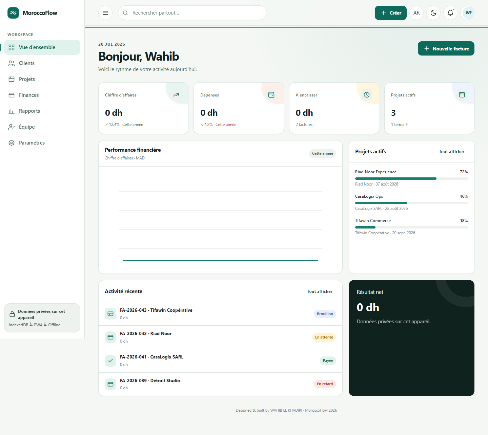
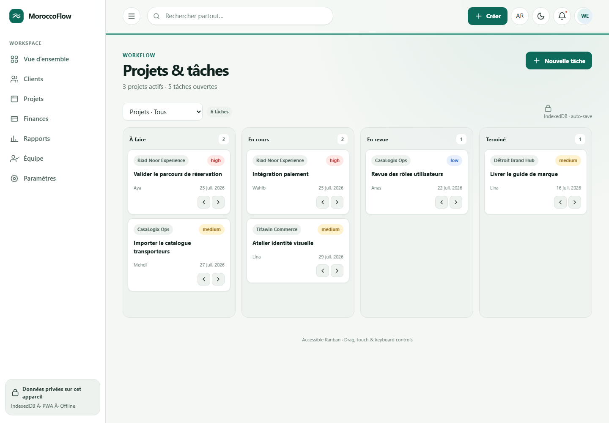
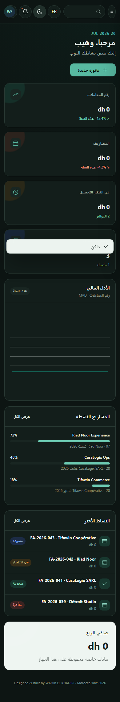

# MoroccoFlow

**Business, in flow.** A bilingual business-management platform for Moroccan companies,
designed and engineered by **WAHIB EL KHADIRI**.

## The problem

A small Moroccan company running on spreadsheets keeps the same four facts in four different
places: who the customer is, what was quoted, what was invoiced, and what was actually paid.
Keeping those four in agreement is manual work, and most software that would fix it assumes one
language, one currency, and a connection that never drops.

MoroccoFlow is one system for that workflow. CRM, quotes, invoices and expenses in dirhams, in
French and Arabic, with the interface mirrored for RTL rather than merely translated. It keeps
working offline and reconciles when the connection returns.

This is a reference implementation, not a product with customers. Every company and person in the
demo data is fictional.



**[Try the live demo](https://wahib-el-khadiri.github.io/MoroccoFlow/)**: portfolio mode on GitHub Pages, with no server and no
sign-up. It seeds fictional data in your browser, and language and direction switch from the
header, so the Arabic RTL layout is one click away. To run it locally, see
[Quick start](#quick-start-portfolio-mode).

## What it includes

- CRM, Moroccan customer records and sales pipeline
- Project and keyboard-accessible Kanban task management
- Quotes, invoices, expenses and revenue tracking in Moroccan dirhams
- Dashboard, Chart.js reports, CSV export and printable PDF layouts
- Team invitations, server-enforced RBAC and append-only audit history
- French and Arabic, RTL/LTR, light/dark themes and responsive layouts
- IndexedDB offline cache, mutation outbox, Service Worker and installable PWA
- Rotating sessions, account lockout, Argon2id passwords and TOTP MFA
- S3-compatible documents with content validation and a scan-gated quarantine workflow

All demo companies and people are fictional. Demo financial values intentionally display `0 dh`.
No template or third-party product source code was copied.

## Runtime modes

- **Portfolio mode** requires no server. It seeds fictional data in IndexedDB and is suitable for
  GitHub Pages.
- **Company mode** is enabled by `VITE_API_BASE_URL=/api/v1`. It uses the Fastify API,
  PostgreSQL row-level security, Redis and private S3-compatible storage while retaining offline
  operation.

## Stack

Frontend: HTML5, CSS3, Vanilla JavaScript ES2026, Web Components, ES Modules, IndexedDB,
Service Worker/PWA, Chart.js 4 and Vite 8.

Backend: Node.js 22, Fastify 5, PostgreSQL 18, Redis 8, S3 API, Argon2id, JWT, Prometheus metrics
and checksummed SQL migrations.

Quality: Vitest 4, Playwright 1.61, axe, ESLint 10, Prettier 3 and GitHub Actions.

## Quick start: portfolio mode

Requires Node.js 22.12 or newer.

```bash
npm ci
npm run dev
```

## Company mode without Docker

Provide your own PostgreSQL, Redis and S3-compatible services. Copy `.env.example` to `.env`,
replace every sample credential, and set the service URLs. Then run:

```bash
npm ci
npm run db:migrate
npm run api:dev
npm run dev
```

The API is available at `http://127.0.0.1:3000`; Vite proxies `/api`. Interactive API docs are at
`/documentation` in development. Docker manifests remain an optional deployment reference and are
not required for development.

Useful commands:

```bash
npm run check          # lint, frontend/backend tests and production build
npm run test:e2e       # desktop and mobile Chromium journeys with axe
npm run test:coverage  # frontend coverage
npm run api:test       # backend security and HTTP tests
npm run db:backup      # custom-format pg_dump plus SHA-256 checksum
npm run format:check
```

## Architecture and security

```text
Browser: Web Components → observable store → IndexedDB/outbox
                                    ↓ HTTPS
API: Fastify → JWT/MFA/RBAC → tenant transaction → PostgreSQL forced RLS
              ↘ Redis rate limits  ↘ S3 quarantine  ↘ metrics/audit
```

Access tokens remain in memory. Refresh tokens are opaque, hashed, rotated and revocable. Offline
mutations use client UUIDs and transactional `Idempotency-Key` records. The runtime database role
cannot bypass tenant RLS or update/delete audit records. The Service Worker excludes API and
authenticated responses from caching.

Read the complete [architecture](docs/architecture.md), [operations runbook](docs/runbook.md) and
[production-readiness assessment](docs/production-readiness.md).

## Accessibility and performance

The UI targets WCAG 2.2 AA with semantic landmarks, visible focus, keyboard Kanban controls,
44-pixel targets, reduced-motion support, non-color status labels and responsive RTL. The saved
mobile audit reports **Performance 95, Accessibility 100 and Best Practices 100**; see the
[Lighthouse report](docs/lighthouse-report.json).

## CI and deployment

The quality workflow runs dependency audit, checksummed migrations, PostgreSQL RLS integration
tests, unit/integration tests, production build and Playwright/axe. The Pages workflow publishes
portfolio mode whenever the repository is public. Company mode requires a separate API deployment
and managed service credentials.

## Screens

| Dashboard                                          | Accessible Kanban                      | Arabic mobile / dark                                      |
| -------------------------------------------------- | -------------------------------------- | --------------------------------------------------------- |
|  |  |  |

## Scope and limitations

- Uploads are held at `scan_status: pending` and refused on download until a scanner reports them
  clean, through the internal `/internal/files/scan-result` endpoint. The scanner itself is not
  part of this repository; the gate and its integration point are.
- Invoices and quotes are generated as documents. No claim is made about conformance with
  Moroccan invoicing, accounting or tax regulation; that requires validation by a qualified
  accountant before any real-world use.
- Company mode has not been run against production traffic.

## Author

Built by **Wahib El Khadiri** — full-stack and systems engineer, Morocco.

[GitHub](https://github.com/WAHIB-EL-KHADIRI) ·
[LinkedIn](https://www.linkedin.com/in/wahib-el-khadiri-a54134283) ·
[wahibelkhadiri06@gmail.com](mailto:wahibelkhadiri06@gmail.com)

Open to work on production web systems and business software. If you are evaluating this
repository, [docs/architecture.md](docs/architecture.md) is the fastest way to see how it fits
together.


## Licence

© 2026 Wahib El Khadiri. All rights reserved.

**This is not open-source software.** It is published for evaluation, and publishing it grants
no licence: copying, modifying, redistributing, using it in another product, or training a
machine-learning system on it all require prior written permission. Reading the source to
evaluate the work is welcome and needs no permission. "MoroccoFlow" and its logo are trade
marks of the author.

Full terms in [LICENSE](LICENSE). Commercial licensing and partnership enquiries are welcome —
contact details above.
