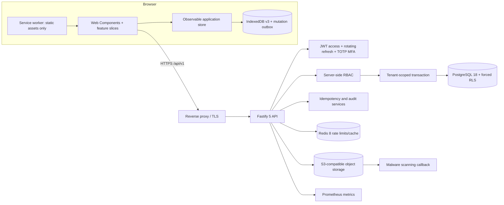

# MoroccoFlow production architecture

MoroccoFlow has two explicit runtime modes. The public portfolio uses local demo data, while
company mode connects the same Web Components UI to the versioned API and retains an encrypted-
in-transit offline cache in IndexedDB.



## Repository boundaries

```text
src/
├── app/              shell, routing, authentication screen
├── core/             API client, IndexedDB, outbox, state, i18n, security
├── design-system/    design tokens and reusable Web Components
├── features/         dashboard, CRM, projects, finance, reports, team, settings
└── shared/           validation, formatting and safe exports

backend/
├── migrations/       checksummed PostgreSQL schema, forced RLS and policies
├── scripts/          migration runner with advisory locking
└── src/
    ├── lib/           RBAC, crypto, idempotency, CRUD and serialization
    ├── plugins/       database, JWT, Redis, S3, audit and observability
    └── modules/       auth, resources, files, insights and team
```

## Security invariants

- Every tenant query runs after `SET LOCAL ROLE moroccoflow_app` and tenant/user session variables.
- PostgreSQL `FORCE ROW LEVEL SECURITY` is the final isolation boundary.
- Access tokens live only in memory. Refresh tokens are opaque, hashed, rotated, revocable,
  `HttpOnly`, `Secure` in production and `SameSite=Strict`.
- Passwords use Argon2id; optional TOTP secrets use AES-256-GCM at rest.
- User-created mutations carry client UUIDs and `Idempotency-Key` values.
- Audit records are append-only for the runtime database role.
- Uploaded files are validated by magic bytes and quarantined until a scanner marks them clean.
- The Service Worker never caches `/api/` or authenticated responses.

Money is represented as integer centimes in persistence and transported without floating-point
rounding. User text is escaped before HTML rendering and CSV formula prefixes are neutralized.
